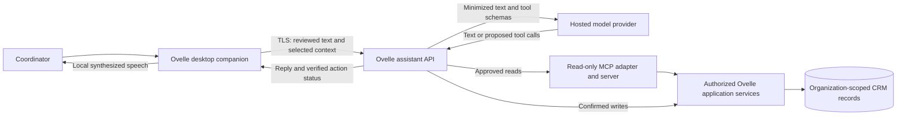
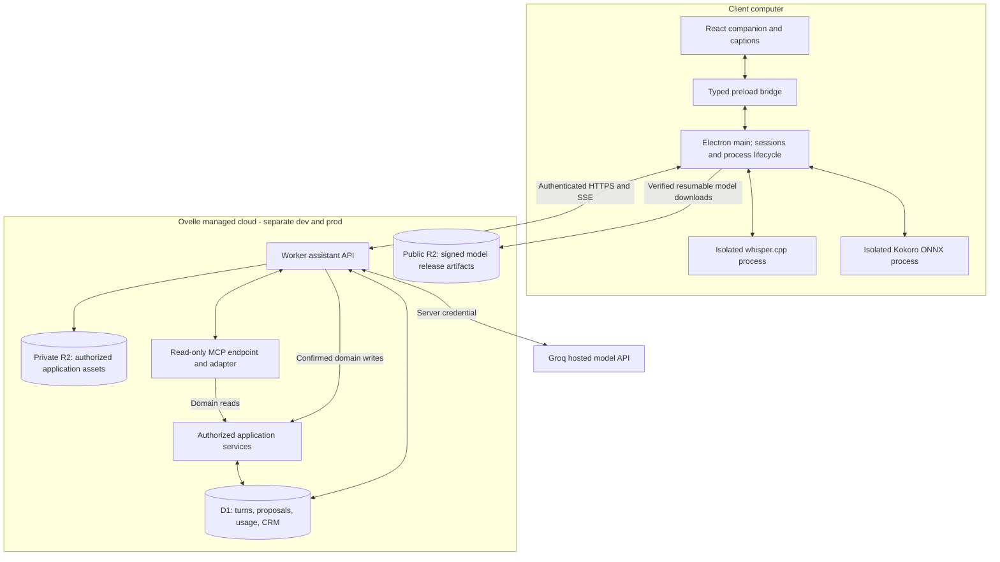
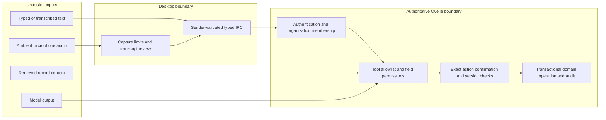

# Ovelle Desktop Assistant — Architecture and Design RFC

| Field | Value |
| --- | --- |
| Status | **Proposed** — documentation only; no assistant is implemented by this RFC |
| Date / source review | October 17, 2026 |
| Audience | Product, desktop, backend, security, operations, and support owners |
| Accountable owner | Ovelle product/engineering owner; role assignments required before pilot |
| Decision scope | Managed desktop voice companion for Ovelle's nonprofit volunteer-management CRM |
| Change control | Update this RFC and its decision records when architecture, data handling, or model policy changes |

## 1. Executive recommendation

Build an Ovelle-branded companion with local speech recognition through
whisper.cpp, local Kokoro synthesis through an ONNX-based runtime, and hosted
reasoning through an Ovelle-controlled API. Start with push-to-talk, editable
transcripts, text chat, captions, and short spoken replies. The character reflects
real application state; it is presentation, not an authority or execution engine.

Use the existing Cloudflare platform for the initial backend: Workers for bounded
request orchestration, D1 for transactional application and assistant records, and
R2 for versioned model distribution. Separate private application storage from
public downloadable assets. Start without Durable Objects, queues, vector search,
GPU servers, or a general-purpose agent framework. Add services only against the
specific triggers in this document.

Use a provider adapter with strictly scoped Ovelle function tools and a
**read-only MCP connection**, mediated by the Ovelle backend. The proposed
first evaluation candidate is **GPT-OSS 20B hosted by Groq**, using its
OpenAI-compatible Chat Completions interface. Compare against the previous GPT-6
Luna baseline; consider Llama 3.1 8B only after an enterprise access/price quote; retain GPT-OSS 120B as a higher-cost
quality control. These are documented offerings, not verified account entitlements
or measured Ovelle results. Selection requires the release evaluation, account
access, and current commercial/data terms [S1–S2, S18–S22].
Do not ship Codex, a shell agent, or provider credentials to customers.

This approach balances a simple installation experience, predictable application
permissions, low speech API spend, and a small initial operating footprint. Its
principal weaknesses are cloud dependence for reasoning, variable local speech
performance, native packaging/licensing work, and application-enforced tenant
isolation in D1. A conventional service with PostgreSQL remains the migration
alternative if those backend constraints become material.

### 1.1 Evidence and decision vocabulary

- **Existing:** observed in the local checkout on the source-review date. A binding
  in configuration does not prove live provider state or deployment acceptance.
- **Confirmed:** product requirements explicitly accepted in the planning chat.
- **Proposed:** engineering defaults recommended here; not an implemented control
  or an approved expansion of the CRM feature list.
- **Validation required:** a benchmark, contract, packaging test, or operational
  exercise must establish the claim before release.

All defaults below are proposed unless marked otherwise. RFC publication approves
neither a deployment nor a claim of security certification, legal compliance,
residency, model quality, or service availability.

## 2. Requirements and current state

### 2.1 Confirmed product requirements

1. Clients install Ovelle and use their Ovelle account. They need no Codex,
   provider account, API key, terminal, Python installation, or manual model setup.
2. Speech recognition and synthesis run locally; reasoning uses an Ovelle-managed
   backend. Transcripts and selected app context can therefore leave the device.
3. Ovelle pays provider costs and supplies a capped allowance per organization.
4. The assistant answers questions, prepares drafts, and executes supported
   changes only after explicit review and confirmation.
5. Launch uses managed cloud hosting. Customer hosting, regional guarantees,
   certifications, and fully offline reasoning are outside this launch baseline.
6. The bot also receives read-only access through MCP. The actual source systems
   and endpoint are not specified; no third-party connection or credentials are
   selected or provisioned by this document.

### 2.2 Repository baseline

| Observed source | Existing capability | Missing dependency / implication |
| --- | --- | --- |
| `apps/desktop/src/main/index.ts` and preload | Electron window, context isolation, sandbox, disabled renderer Node integration, narrow download-related IPC | No assistant session manager, speech worker, microphone workflow, or desktop credential/session design |
| `apps/desktop/package.json` | Windows x64 and Intel/Apple silicon Mac packaging commands; Mac signing identity is unset | Signing, notarization where applicable, native binary integrity, supported OS matrix, and safe updates need release work |
| `packages/ui` and app dependencies | Shared `@ovelle/ui` consumption | Companion components require the repository's Figma/source/variant/accessibility workflow; this RFC changes no component |
| `wrangler.jsonc` | Separate development/production Worker, D1, and R2 configuration | Configured resources are not a deployed assistant; environment routing and secrets need explicit verification |
| `src/cloudflare/worker.ts`, migrations | Downloads, download email, health, and database connectivity plumbing | No CRM login, organization authorization, domain tool services, assistant API, or usage ledger |
| `docs/feature-list.md` | Incremental nonprofit CRM planning; detailed behavior remains proposed | An assistant cannot safely automate domain behavior that has not been defined and implemented |

Inspect these sources again when implementation starts; this is a dated snapshot.
Maintain direct Wrangler ownership, without introducing Terraform. Preserve the
separation of local changes, CI results, deployed selection, and live acceptance.

### 2.3 First-release boundary

Ship English interaction for coordinators first, with organization-admin opt-in.
Start with help, permission-scoped record lookup, and an allowlisted change to an
internal draft note once that domain service exists. A draft note must be marked
non-authoritative; it cannot modify readiness, attendance, verified hours, or
signed records. Tool names in this RFC are proposed interfaces, not existing CRM
features. Additional actions require their own domain validation and evaluation.

Do not initially expose payments/refunds, signature execution, emergency-contact
or screening data, permanent deletion, bulk exports, external message sending,
arbitrary SQL, arbitrary file access, shell commands, or computer control.
Drafting a message does not send it. Submitted hours, verified hours, donations,
pledges, and calendar RSVP remain distinct domain concepts.

## 3. Architecture and trust boundaries

### 3.1 System context



### 3.2 Deployment



Models are public assets only if redistribution is cleared. Never mix public
model/release hosting with private documents or SQL backups. Do not repurpose the
current downloads bucket for private data without proving its access boundaries.

### 3.3 Trust boundaries



The desktop is not trusted to assert permissions, costs, record versions, or
organization membership. The model is not trusted to authorize an operation.
Downloaded models and native binaries are supply-chain inputs, not executable
content the renderer may load from arbitrary paths. The operating system and
local administrators can inspect device memory; this design does not protect
against a fully compromised endpoint.

### 3.4 Responsibilities and dependencies

| Subsystem | Owns | Must not own |
| --- | --- | --- |
| Shared UI | Companion states, captions, transcript editor, review card, keyboard controls | Provider credentials, subprocesses, business permissions |
| Renderer | Microphone capture via permissioned media APIs, bounded PCM framing, playback and local amplitude animation | Node access, arbitrary IPC, direct provider calls |
| Preload | Versioned, typed, sender-checked IPC surface; unsubscribe support | Generic command execution or filesystem bridge |
| Electron main | Login lifecycle, OS-protected token storage, download verification, speech-process lifecycle, stream cancellation | Domain authorization or model-driven execution of native commands |
| Speech processes | Bounded local inference and framed PCM/text messages over private pipes | Network access by design, application credentials, arbitrary user-supplied executable paths |
| Assistant Worker | Request authentication, context selection, provider adapter, bounded tool loop, cost reservation | Native model inference, arbitrary background jobs, unsanitized provider proxy |
| MCP adapter / server | Reviewed read-tool catalog, delegated identity, bounded retrieval and provenance | Write capabilities, arbitrary server discovery, model-selected URLs, provider-managed credentials |
| Application services | Organization and field authorization, validation, transactional writes, audit and idempotency | Trust in model instructions or client-supplied membership |
| Provider adapter | Normalized text/tool/usage events, timeouts and error classification | Permission policy or automatic cross-provider disclosure |

Use a small subprocess protocol over stdio/private pipes with request IDs, size
limits, deadlines, and process restart limits. Drain stderr separately; audio and
transcripts must not appear in diagnostic logs. Process isolation prevents a
crash from taking down the renderer but is not itself an OS security sandbox.
Validate platform-specific sandbox options before claiming process containment.

## 4. Interaction, interfaces, and execution semantics

### 4.1 Voice lifecycle

The user presses a microphone control, sees an unmistakable recording indicator,
and releases/stops it to transcribe. Limit a capture to 30 seconds. Convert to the
speech engine's required PCM format locally. Show the editable transcript before
Send; never automatically submit an unreviewed voice transcript in v1. Reject
empty/silence-only captures and ask for clarification when entities or dates are
ambiguous. Do not use a model's self-reported confidence as an authorization gate.

Keep text input available before model downloads finish. First enablement offers
an automatic, resumable voice-pack download with size/progress/cancel controls.
There is no terminal or separate runtime installer. Start with `base.en`; offer
an automatically managed `small.en` accuracy option only after hardware testing.
Initial voice is one cleared English preset; voice cloning is excluded.

Use states `idle`, `recording`, `transcribing`, `reviewing`, `thinking`,
`awaiting_confirmation`, `executing`, `speaking`, `offline`, and `error`.
Captions and review controls remain usable without the animated character.
Stop playback when recording starts so the assistant does not transcribe itself.
Mute suppresses synthesis/playback, not the text reply. Speech summarizes the
result; record links and detailed evidence remain visible onscreen.

### 4.2 Minimum application contracts

Version the assistant API under `/api/assistant/v1`; return stable application
errors rather than raw provider error bodies. This is a proposed contract, not
implemented API documentation.

| Interface | Minimum input / output and behavior |
| --- | --- |
| `POST /turns` | Reviewed text, conversation ID if present, selected organization, client request ID; server returns turn ID and initial state after membership validation and budget reservation |
| `GET /turns/{id}/events` | Authenticated fetch-based SSE with monotonically increasing event IDs: status, text delta, proposal, action outcome, usage, terminal error/completion; heartbeat every 15 seconds |
| `GET /turns/{id}` | Authoritative state, bounded accumulated reply, proposals and action references; supports recovery without another model call |
| `POST /turns/{id}/cancel` | Idempotent cancellation request; stops further generation/tools where possible and reports already committed actions |
| Internal `prepareAction` | Strict tool name/arguments; server creates immutable proposal, canonical argument digest, target versions, actor/org, expiry, review summary, and proposal ID |
| `POST /proposals/{id}/confirm` | Proposal ID, exact digest and idempotency key; authenticated explicit button/keyboard action; no acceptance inferred from model text or spoken “yes” |
| `GET /actions/{id}` | Durable outcome: pending, committed, failed, or reconciliation required; no model required to inspect a receipt |
| `GET /usage` | Current UTC monthly period, consumed/reserved turn allowance, remaining amount and reset time; expose user-facing usage, not provider secrets |

Conversation and turn IDs are opaque identifiers, not access grants. The server
resolves the actor and organization context for every request and nested record.
Use an access token in an authorization header; never in the SSE URL. Preload
exposes specific methods such as startTurn, subscribeTurn, cancelTurn,
confirmProposal, getAction, startCapture, stopCapture, and stopPlayback, with
runtime validation of payload size, sender frame, and origin [S15].

### 4.3 Request sequence and confirmation

```mermaid
sequenceDiagram
    actor User
    participant Desktop
    participant Speech as Local speech process
    participant API as Ovelle API
    participant Model as Hosted model
    participant MCP as Read-only MCP
    participant Domain as Domain service / D1
    User->>Desktop: Hold microphone, speak, release
    Desktop->>Speech: Bounded local PCM
    Speech-->>Desktop: Transcript
    User->>Desktop: Review/edit and Send
    Desktop->>API: Start turn with reviewed text
    API->>Domain: Authenticate, authorize, reserve allowance
    API->>Model: Minimized context and allowlisted tools
    Model-->>API: Read call or proposed change
    alt Read tool
        API->>MCP: Allowlisted call with delegated actor/org scope
        MCP->>Domain: Authorized read
        Domain-->>MCP: Scoped records and versions
        MCP-->>API: Bounded result and provenance
        API->>Model: Validated authorized tool result
        Model-->>API: Grounded reply or next bounded tool call
    else Proposed write
        API->>Domain: Prepare immutable proposal
    end
    API-->>Desktop: Text, citations, proposal and exact digest
    opt A write proposal exists
        User->>Desktop: Review and explicitly confirm
        Desktop->>API: Confirm proposal and digest
        API->>Domain: Recheck permission, versions, expiry; commit once
        Domain-->>API: Stored operation receipt
        API-->>Desktop: Verified outcome
    end
    Desktop->>Speech: Final short reply text for synthesis
    Speech-->>Desktop: Local PCM playback
```

Confirmation expires after five minutes and is bound to one actor, organization,
tool/version, canonical arguments, and expected record versions. Any change
requires a new preview. A different actor must obtain a new proposal. Recheck
membership, roles, readiness/capacity constraints where relevant, and current
record versions at commit time; a previously authorized read is insufficient.

For v1 internal writes, store the domain mutation, consumed proposal,
idempotency result, and audit event in one database transaction/batch with
conditional writes and uniqueness constraints. Verify the actual D1 transaction
and conditional-update behavior before enabling writes. Claiming a proposal in
one transaction and mutating later without recovery is not sufficient. A duplicate
confirmation returns the original receipt; it must not execute again.

The model may propose and describe a change but cannot mark it successful. Emit
success only from a committed domain receipt. State “not changed” on validated
failure and “checking whether it completed” on an unresolved outcome. Do not speak
partial generated claims of successful actions before the receipt exists. External
side effects are excluded until a transactional outbox, provider idempotency,
and reconciliation path are implemented; there is no general exactly-once promise.

### 4.4 Read-only MCP integration

**Placement:** Ovelle's backend acts as the MCP client. Start with an
Ovelle-managed read-only endpoint over HTTPS Streamable HTTP; reuse domain read
services, not unrestricted database access. This is a deployment default, not a
claim that the user's unspecified MCP server already exists. External sources
require a separate endpoint, data classification, contract and permission review.
Clients do not configure MCP or run a local server. Avoid a desktop relay unless
a later requirement establishes device-only data.

**Model bridge:** expose approved MCP reads as ordinary model function definitions.
When the model requests one, the backend validates arguments, resolves scoped
identity, invokes MCP, validates/minimizes the result, and sends authorized context
back to the model. Groq need not host or natively execute MCP for this to work.
Do not provide its hosted remote-MCP/browser/code tools for this connection.

**Catalog and read enforcement:** register a reviewed server/tool/schema allowlist;
use discovery only to verify that catalog. Newly advertised tools and changed
schemas remain disabled pending review. Do not trust a name, description, or
`readOnlyHint` annotation to prove absence of side effects. Enforce read-only
behavior in the MCP implementation, domain authorization, and underlying resource
permissions where supported. Refuse tools that mutate business data, send messages,
run arbitrary SQL, expose unrestricted files, or change permissions. Logs and
quota counters may change operationally; “read-only” concerns business data and
external side effects. The protocol's tool metadata is not an authorization policy
[S25]. Confirmed mutations remain outside MCP in the existing proposal/receipt path.

**Identity:** bind each call to the current actor and organization; the server
rechecks row/field permissions. For HTTP MCP use the protocol's authorization
flow and audience-bound, least-privilege tokens issued for that MCP resource [S26].
Do not pass the desktop access token or model-provider key through as an MCP token.
Do not fall back to an unrestricted service credential when delegated authorization
fails. Session IDs are not identity; any reuse must preserve organization and actor
isolation. Endpoint URLs are deployment-controlled, HTTPS-only and allowlisted;
validate redirects and reject model-selected/private-network destinations.

**Retrieval defaults:** cap all reads, including MCP reads, at eight calls per turn,
with a ten-second per-call timeout inside the existing 90-second turn deadline.
Allow one retry for an idempotent transient read failure, counted inside that
same eight-call budget. Return at most twenty records and 16 KiB per call, with
an explicit continuation cursor. Bound the combined model input, including tool
schemas and results, to the existing 12,000-token invocation limit. Reject oversized
results before provider submission rather than silently dropping important fields.
Return source/record references, relevant versions, and retrieval time for grounding;
counts and totals require a dedicated scoped aggregate read, not inference from a
single page. No whole-database or document dump.

**Failure/privacy:** treat returned text and embedded instructions as untrusted.
Do not automatically fetch resource links or forward content to a new host. Reads
need no action-confirmation dialog within the user's authorized scope, but respect
first-use cloud-processing disclosure. MCP cannot grant access to sensitive fields
excluded elsewhere in this RFC. Keep results turn-scoped with the existing retention;
no shared result cache initially. On denial, timeout, missing source, or truncated
coverage, report the limitation and do not invent an answer or change. Do not replay
MCP reads while recovering a completed turn just to reconstruct stored output.

### 4.5 Failure and recovery behavior

| Condition | Required behavior |
| --- | --- |
| Offline before Send | Preserve reviewed text locally in memory; show offline; no automatic submission or delayed execution when connectivity returns |
| Connection lost after start | Recover using original client request ID/turn lookup; never start a replacement turn blindly |
| SSE disconnect | Resume retained events using cursor; if expired, return authoritative accumulated state rather than replaying tools |
| User cancels | Stop playback immediately; abort provider work best-effort; prevent new tool dispatch; cancellation cannot undo a committed write |
| Cancel races with confirmation | Transactional action state decides outcome; display receipt for commits that won the race; never imply rollback |
| Worker dies / turn times out | Watchdog marks orphaned work failed or reconciliation-required, releases safe reservations, and preserves committed receipts |
| Provider 429/5xx | One bounded retry only for eligible pre-output generation failures; respect Retry-After within deadline; no automatic retry after partial output |
| Speech process crashes | Restart at most once per interaction; preserve text mode; never upload audio as a hidden fallback |
| Model pack invalid or incomplete | Do not load it; retain last verified version; show retry and text mode |
| Confirmation is stale / permission revoked | Reject with a new-review requirement; do not silently repair and execute changed arguments |
| Execution response lost | Query action receipt or repeat same idempotency key; never reapply with a fresh key |

Persist a bounded event log/accumulated response during generation. Resume works
only for retained events; clients fall back to state lookup after retention expiry.
A request-bound Worker does not promise background completion when a client
leaves. Use an explicit 90-second turn deadline, generation aborts, and a scheduled
orphan sweep. If background execution becomes a requirement, revisit coordination.

## 5. Architecture decisions and alternatives

### 5.1 Evaluation method

Apply hard requirements before scoring: no customer technical setup, local speech,
server-authorized writes, explicit confirmation, and an Ovelle-funded allowance.
Cloud-only speech and unconfirmed autonomous execution fail those requirements
regardless of score. Scores below are engineering judgments, not benchmarks.

Use 1 (poor fit) through 5 (strong fit), with weighted total
`sum(weight × score) / 100`. Weights prioritize correctness/control (30%) because
incorrect CRM writes can affect real volunteers; privacy (20%) because records
are sensitive; latency/UX (15%) for conversational use; total cost (15%) for an
included allowance; operability (15%) for the small initial team; and portability
(5%) to acknowledge lock-in without making multi-cloud a launch project.

| Approach | Control 30% | Privacy 20% | UX 15% | Cost 15% | Operability 15% | Portability 5% | Total / 5 |
| --- | ---: | ---: | ---: | ---: | ---: | ---: | ---: |
| Local speech + Workers/D1 + hosted reasoning | 4 | 4 | 4 | 5 | 5 | 3 | **4.25** |
| Local speech + container/PostgreSQL + hosted reasoning | 4 | 4 | 4 | 3 | 3 | 5 | **3.75** |
| Local speech + entirely local language model | 3 | 5 | 2 | 4 | 2 | 4 | **3.30** |

The first option wins provisionally through existing platform fit and reduced
operating work, not demonstrated model accuracy. If local language quality fails
or cloud privacy is unacceptable, scoring cannot waive that release failure.
Re-score with measured latency, support load, and cost after the pilot. A team
with PostgreSQL operations already in place could reasonably weight differently.

### ADR-01 — Cloudflare backend, with bounded orchestration

**Requirements:** organization isolation, durable receipts, authenticated streaming,
small operating footprint, separate environments. **Decision:** reuse Workers and
D1, with indexed organization-qualified queries and explicit authorization in a
shared application-service boundary. D1 does not provide a PostgreSQL-style row
security policy as the tenant boundary; application mistakes remain a serious risk.

**Alternatives:** a container service plus managed PostgreSQL offers conventional
transactions, database row policies, long-running processes, extensions, and
broader hosting portability. It also adds service/database provisioning, connection
management, patching, and baseline cost. Customer-hosted infrastructure multiplies
release and support surfaces and is outside confirmed launch requirements.

**Drawbacks:** Workers runtime/CPU constraints, D1 database size and contention,
provider coupling, and request-lifetime recovery work [S7–S9]. Keep inference on
the device or model provider, not inside a Worker. D1's paid per-database ceiling
is documented as 10 GB; plan a partition/migration exercise at 7 GB [S9]. Do not
assume a large account storage allowance removes that per-database ceiling.

**Coordination:** initially use unique constraints, atomic conditional reservations,
lease timestamps, heartbeats, and a scheduled orphan sweep in D1. Do not use KV
for hard quotas or proposal consumption. Introduce an organization-scoped Durable
Object if contention/serialization tests fail or coordination exceeds 100 ms p95;
introduce a queue/workflow only for explicitly required durable asynchronous work.
An assistant service exceeding 1% database-contention errors at the defined pilot
load, or failing transaction semantics tests, blocks writes and triggers an ADR
review. A service/SQL adapter boundary helps migration but does not make it free.

**Evidence:** repository configuration and published limits; no production load
benchmark or transaction proof. **Revisit:** failed isolation/transaction tests,
7 GB database threshold, chronic contention, durable background tasks, or residency
requirements.

### ADR-02 — Model API and domain tools rather than a coding-agent runtime

**Decision:** a provider-neutral adapter, initially Groq Chat Completions, and a
bounded tool loop. Ovelle owns the conversation UX, context policy, action
preparation, and confirmation. Server-side JSON-schema validation rejects malformed
tool arguments; do not assume provider-constrained decoding for tool calls.
Disable all built-in web, shell, computer, file, and code-execution tools at launch.

Codex App Server is a documented embedding interface with authentication, history,
approvals, and streamed events [S6]. It could be bundled without asking customers
to install Codex themselves. The rejection is therefore a product/operating fit
decision: a coding-agent runtime introduces native lifecycle, workspace, and
approval semantics that the CRM does not need. Its approval system would not
replace Ovelle's domain permissions. A general agent SDK is also unnecessary for
one bounded tool loop; adopt one only for a demonstrated orchestration benefit.

A local language model removes hosted inference dependence but adds model-sized
installation, hardware variability, quality/evaluation work, and update/support
burden. It is not a guaranteed free equivalent. Another hosted provider remains
possible behind the adapter, but requires its own contracts, data review, tool
mapping, and evaluation; never silently fail over customer data to an unapproved
provider.

**Evidence:** official integration docs and repository scope; comparative effort
and quality remain estimates. **Revisit:** coding/workspace capabilities become
an explicit requirement, orchestration materially grows, or offline reasoning
becomes mandatory.

### ADR-03 — Local whisper.cpp recognition

**Decision:** pin and package native whisper.cpp per supported OS/architecture;
start with `base.en`, then evaluate `small.en` for optional improved recognition.
Its CPU path and platform acceleration make it a plausible desktop fit [S10].
Do not advertise real-time recognition or accuracy from upstream sample results.

| Alternative | Benefit | Reason not selected initially |
| --- | --- | --- |
| faster-whisper / CTranslate2 | Another optimized Whisper runtime; suitable comparison on target hardware [S11] | Python/native dependency packaging and platform validation add work; benchmark could overturn this choice |
| Other small local recognition engines | Potential latency or model-size improvements | New language/accent and entity-recognition evaluation required; keep a replaceable recognition interface |
| Hosted transcription | Centralized model updates and less device inference work | Violates local-speech requirement; adds audio disclosure, network dependence, and per-minute cost |

**Drawbacks:** CPU/battery consumption, accents/noise, proper-name errors, limited
English-only launch, disk use, and different acceleration paths. Silence can
produce erroneous transcripts; use speech detection, capture limits, and review,
not blind trust in decoded text. **Evidence:** upstream runtime support; no Ovelle
hardware measurements. **Revisit:** recognition or latency gates fail, especially
on Intel Macs and low-end Windows devices.

### ADR-04 — Local Kokoro, subject to distribution clearance

**Decision:** Kokoro-82M with a pinned ONNX runtime path and one cleared preset.
An existing Kokoro ONNX implementation is an integration candidate; package any
required runtime with Ovelle, not a user-managed Python environment [S12–S13].
Prefer a quantized artifact only after listening and pronunciation tests. Treat
upstream size and speed claims as candidate characteristics, not installer budgets.

| Alternative | Benefit | Drawback / decision |
| --- | --- | --- |
| Piper | Local neural speech, another candidate for modest hardware | Current maintained engine is GPL-3.0; voice terms differ. Not automatically forbidden, but distribution obligations need separate review [S14] |
| OS voices | Lower additional model/download burden | Voice availability, offline status, quality, and consistency differ across installations; only an explicitly verified offline voice may be offered as a user-selected alternative |
| Hosted TTS | Consistent delivery and easier model management | Violates local synthesis requirement; adds recurring cost and network dependence |

Kokoro's weights are Apache-2.0; this does not clear the whole speech stack or
prove the resulting voice is exclusive to Ovelle [S12]. Confirm notices and
redistribution obligations separately for runtime, voices, phonemizer, and data
artifacts. **Evidence:** model card and runtime repositories; no packaged binaries
or voice clearance. **Revisit:** licensing cannot be satisfied, quality fails, or
hardware/support costs exceed the operating budget. Fall back to text if clearance
fails, not an unreviewed cloud voice.

### ADR-05 — Push-to-talk and reviewed transcripts

**Decision:** push-to-talk first; microphone is off by default. Hands-free adds
wake-word detection, echo cancellation, speech endpointing, interruptions, ambient
capture risk, and more difficult shared-office behavior. It may feel more natural
but expands privacy and test scope. Review adds a deliberate Send step and slows
conversation; it helps users catch names, dates, and private context before upload.
**Evidence:** workflow/control rationale, not a measured usability win.
**Revisit:** pilot users demonstrate a material accessibility or efficiency need;
retain an equivalent text/keyboard path.

### ADR-06 — Hosted model selection and bounded use

**Revised decision:** evaluate Groq-hosted `openai/gpt-oss-20b` first, rather
than selecting a premium model or limiting the comparison to one provider.
Its published uncached rates are lower than the previous Luna baseline on both
input and output, and it documents reasoning and tool-use support [S18]. This is
a cost/capability-fit hypothesis, not a claim that it outperforms Luna on Ovelle.
The model's OpenAI authorship does not mean this API is hosted by OpenAI; Groq's
service terms, retention controls, quotas, and billing govern this deployment.

Rates are standard USD per million tokens, reviewed October 17, 2026. Compare
uncached prices without trial credits, free-tier capacity, batch discounts, or
assumed cache hits. Account availability and workload results remain unverified.

| Candidate / host | Input / output | Evaluation role | Capability rationale and limitation |
| --- | ---: | --- | --- |
| GPT-OSS 20B / Groq | $0.075 / $0.30 | Proposed first candidate | Documented reasoning and tool use; both rates lower than Luna; task accuracy and end-to-end latency unmeasured [S18] |
| Llama 3.1 8B Instant / Groq | Quote required | Conditional small-model challenger | Current official model page marks it Enterprise and publishes no token rates; historical low prices are not a verified offer. Test tool quality only after access and price are confirmed [S20] |
| GPT-6 Luna / OpenAI | $0.10 / $0.50 | Previous baseline / comparison | Keep as a control, not a default selected without cross-provider evidence [S1–S2] |
| GPT-OSS 120B / Groq | $0.15 / $0.60 | Higher-cost quality control | Same model family with documented reasoning/tool support; twice 20B token rates, with no proven successful-task advantage [S21] |

Gemini 3.1 Flash-Lite's published $0.25/$1.50 and DeepSeek Flash's peak uncached
$0.30/$1.20 (off-peak $0.15/$0.60) do not beat 20B on these uncached token rates
[S23–S24]. This does not rank their quality. Caching, fewer retries, and task success
could change the economics; do not base an interactive service on off-peak-only
prices. Free-model routing is excluded from production capacity planning because
we need a named host, approved data handling, stable quotas, and a paid allowance.

**Integration constraint:** use Groq's function-calling interface for tools
executed by Ovelle application services, stream natural-language replies where supported, and validate completed tool
calls on the server before preparation. Do not execute partial streamed arguments.
Groq documents that strict Structured Outputs cannot currently be combined with
streaming or tool use [S19]. Do not enable `response_format: json_schema` on those
turns or describe tool arguments as guaranteed schema-compliant. Reject malformed
calls; one explicit correction invocation may use the remaining normal turn budget,
never an unbounded repair loop. The server builds the action preview from validated
arguments and domain records. Any future schema-only extraction step is a separate
non-streaming, no-tools request counted inside the same invocation/cost limits.

Evaluate all candidates on the same held-out tasks, context, tools, and limits.
Grade exact tool/argument correctness, justified abstention, grounded answer
quality, latency, successful-task cost, and repeated-run variance. The 20B candidate
must pass every security and quality gate and match or improve Luna's held-out
accuracy, at lower cost per successful task on the same corpus. Llama 8B can replace it only if it independently passes
those gates at lower successful-task cost. Do not claim greater capability from
parameter counts, vendor benchmark descriptions, or lower prices. A failure pauses
rollout; no automatic provider/model escalation or disclosure to an unapproved host.

Set at most four normal model invocations per turn, one additional eligible retry,
12,000 input tokens per invocation including history/tool results, 2,000 output
tokens including any billed reasoning, eight read tool calls, and one prepared
write per turn. Use low reasoning effort for GPT-OSS initially and verify provider
token limits and reasoning accounting. Never forward hidden reasoning text to
captions or TTS. Pagination and bounded field selection are required; never silently truncate action arguments. Refuse or narrow
requests exceeding context limits.

Maintain a versioned model/prompt/tool/price manifest. Pin immutable model snapshots
where offered. Where only a mutable model ID is available, record that limitation,
run daily canaries, and pause on regressions; do not call an alias immutable.
**Evidence:** published availability/features/rates only. **Revisit:** quality
failure, deprecation notice, cost change, data-control change, or account limits.

## 6. Security, privacy, and supply chain

### 6.1 Identity and authorization prerequisites

An Ovelle authentication/session design must precede the assistant. Use short-lived
access tokens, revocable rotated refresh sessions, OS-protected desktop storage,
and an audited organization-membership/role system. This RFC does not select a
new identity provider or invent a separate assistant login. Verify OS-backed
credential protection on each platform; do not ship plaintext token fallback.

Derive actor and authorized organization on the server. Qualify every record query,
foreign-key lookup, proposal, event stream, export, and usage lookup by that scope.
Reject cross-organization identifiers even when they exist. Include organization
and permissions in any cache key; disable shared caching of private responses.
Use parameterized SQL and an application-service layer shared with normal UI
operations. A model cannot elevate privileges by choosing another tool or ID.

Initial tools read only fields explicitly required for the task. Exclude emergency
contacts, screening material, signatures, payment credentials, and unrelated
volunteer personal details. Use pseudonymous references where names are unnecessary.
Do not retrieve whole databases or documents to make context selection easier.

Treat user input, records, attachments, and model output as untrusted data.
Retrieved text cannot add tools, grant permissions, or change system instructions.
Escape rendered content, restrict links, validate tool schemas at runtime, and
never pass model text to SQL, shell, eval, or native process arguments. Prompt
injection remains possible; hard authorization limits its consequences rather
than promising to eliminate it.

### 6.2 Data handling and proposed retention defaults

| Data class | Location and default | Deletion / caveat |
| --- | --- | --- |
| Raw microphone audio | Device memory only; bounded capture and synthesis buffers | Release after processing/cancel; no deliberate file retention, analytics upload, or crash attachment; OS swap/dumps are outside a perfect-erasure guarantee |
| Unsent transcript | Device memory while composer is open | Clear on discard/sign-out; no automatic cloud send or cross-session persistence |
| Submitted transcript, answer, minimized tool results | Private server conversation storage, seven days | User deletion removes live conversation content within 24 hours; no cross-user conversation sharing |
| Stream event chunks | Private D1, up to 24 hours within conversation retention | Collapse to bounded accumulated text; expired cursor uses state lookup |
| Expired proposal payloads | Private D1, up to 24 hours; usable only for five minutes | Clear arguments after retention; keep minimal action/audit references where necessary |
| Action receipts and audit metadata | Private D1, 90 days | Store actor/org, tool/version, target reference, digest, outcome, time; avoid full personal before/after payloads; domain record retention is separately governed |
| Usage and reservation ledger | Private D1, 90 days | Retain token/cost totals and operational references, not transcript text |
| Operational logs | Redacted, access-restricted, 14 days | No raw audio, prompts, answers, auth headers, tool payloads, or private document content |
| Encrypted application backups | Private storage, maximum 30-day rotation | Restore runbook must reapply deletion tombstones before serving traffic; deletions are not instant removal from backups |
| Provider requests | Minimized text and schemas; stateless Groq Chat Completions, organization ZDR enabled and verified; no hosted files/batch/fine-tuning | Provider-specific controls and contract govern; OpenAI comparison calls separately use `store: false` and their own reviewed settings |

These defaults are engineering proposals, not legal conclusions. Product/privacy
owners must approve the schedule and notices before real customer data enters a
pilot. Disable diagnostic core dumps/content capture where feasible and document
any unavoidable platform behavior. Organization deletion revokes sessions,
invalidates pending proposals, and schedules content cleanup; it does not erase
an independently required CRM record or instantly purge provider logs.

For Groq, enable and verify organization-level Zero Data Retention before customer
pilot traffic; disable features requiring persisted state. Its documentation says
normal inference content is not retained by default, but reliability/abuse logs can
otherwise retain content for up to 30 days; ZDR is a separate setting. Usage metadata
is still retained [S22]. Record account configuration and contractual review as
release evidence; publishing this RFC does not establish that ZDR is enabled or
remove our own database/backups from the data inventory.

For any OpenAI-hosted comparison, OpenAI distinguishes abuse-monitoring logs from
application state. API data is not used for training by default unless opted in; default abuse logs can retain content
for up to 30 days, subject to stated exceptions. `store: false` does not establish
Zero Data Retention. ZDR/modified monitoring require approval and have endpoint/model
conditions [S5]. Recheck the actual account settings and contract; do not advertise
ZDR, regional processing, or compliance certifications from this RFC.

### 6.3 Local and provider secrets

Store provider keys only in environment-specific server secrets; rotate and audit
them, cap project spend, and exclude them from desktop bundles, manifests, logs,
and client error messages. Use separate development and production provider
projects and synthetic development data. Restrict administrative access and audit
operator actions. Private documents require authenticated retrieval and short-lived
scoped access; public R2 URLs cannot enforce CRM permissions.

### 6.4 Distribution inventory and integrity

| Layer | Candidate / observed license evidence | Required release work |
| --- | --- | --- |
| Recognition runtime | whisper.cpp MIT [S10] | Pin source/binary revision; reproduce build and notices |
| Recognition weights | Selected Whisper artifact | Record upstream origin, weight license, checksum, conversion/quantization provenance; runtime license alone is insufficient |
| TTS model weights | Kokoro-82M Apache-2.0 [S12] | Retain model license/notices and verify exact selected export |
| TTS wrapper | kokoro-onnx MIT candidate [S13] | Pin version, inventory dependencies, bundle runtime with app |
| Inference runtime | ONNX Runtime candidate | Inspect selected distribution's license/notices and native dependencies before packaging |
| Voice and language data | One identified preset and required dictionaries | Record artifact-specific provenance and terms; do not claim voice exclusivity |
| Phonemizer | Chosen G2P path; eSpeak NG may enter dependency graph | eSpeak NG is GPL-licensed; inspect actual bundling and redistribution obligations separately [S16] |
| Alternative TTS | Maintained Piper engine GPL-3.0 [S14] | Review engine and individual voice terms independently if adopted |

“Proprietary Ovelle experience” describes our application and service integration;
it does not change upstream licenses or make third-party weights proprietary.
Legal/distribution review is a release gate; no assertion here establishes whether
any particular combined distribution meets its obligations.

Sign application releases, validate platform signing/notarization as applicable,
and ship a signed model manifest containing artifact digest, size, architecture,
engine compatibility, license inventory version, and minimum app version. Pin the
manifest verification key in the signed application. Download to a temporary path,
verify size/signature/hash, then atomically activate; reject traversal, symlinks,
unexpected executables, and downgrade attempts. A hash from an unauthenticated
manifest is not an authenticity check. Support resumable downloads, disk-space
checks, cache cleanup, last-known-good rollback, and staged model updates. Signing
and updates are missing prerequisites, not existing protections.

## 7. Economics and enforceable limits

### 7.1 Dated rate card and calculation method

Planning rates in USD, checked October 17, 2026; taxes, contracts, currency
conversion, shared account consumption, and future price changes are excluded.
Rates are not a provider quote or a guarantee of free capacity.

| Meter | Published rate / included capacity used here | Source |
| --- | --- | --- |
| Groq GPT-OSS 20B tokens | $0.075 input / $0.30 output per million; no cache discount assumed | [S18] |
| Workers Standard paid | $5/month; 10 million requests and 30 million CPU-ms; overage $0.30/million requests, $0.02/million CPU-ms | [S7] |
| D1 paid | 25 billion reads, 50 million writes, 5 GB included monthly; overage $0.001/million reads, $1/million writes, $0.75/GB-month | [S8] |
| R2 Standard | $0.015/GB-month, $4.50/million Class A, $0.36/million Class B; free tier 10 GB-month, 1 million A, 10 million B; direct Internet egress free | [S17] |

For `T` turns, `c` mean model invocations per turn before retries, `r` retry
uplift, `I` mean input tokens/invocation, and `O` mean billable output tokens:

```text
AI = T × c × (1 + r) × (I × input_rate + O × output_rate) / 1,000,000
Workers = 5 + max(0, requests - 10,000,000) × 0.30 / 1,000,000
            + max(0, CPU_ms - 30,000,000) × 0.02 / 1,000,000
D1 = max(0, reads - 25,000,000,000) × 0.001 / 1,000,000
     + max(0, writes - 50,000,000) × 1 / 1,000,000
     + max(0, stored_GB - 5) × 0.75
Support = monthly_assistant_support_hours × loaded_hourly_rate
Total = AI + Workers + D1 + R2 + operations_contingency + Support + external_MCP_fees
```

Count repeated context, schema tokens, tool results, and reasoning in actual
provider usage; a user-visible reply is not the whole bill. MCP supplies context,
not cheaper inference: its schemas/results add input tokens, and follow-up tool
rounds add model calls. The existing invocation and context caps still apply.
The retry uplift is an expected-load assumption, not permission to exceed the hard invocation limit.
Apply R2 free capacity and round billable units according to provider rules, not
fractional-request arithmetic. Model downloads use public R2 directly so they do
not intentionally create a Worker invocation for every chunk.

### 7.2 Monthly fleet scenarios, not forecasts

| Assumption | Low pilot | Expected adoption | High stress case |
| --- | ---: | ---: | ---: |
| Organizations × turns/organization | 10 × 100 | 100 × 500 | 1,000 × 2,000 |
| Total submitted turns | 1,000 | 50,000 | 2,000,000 |
| Mean invocations/turn before retry | 1.2 | 1.6 | 2.5 |
| Retry uplift | 2% | 5% | 10% |
| Input / output tokens per invocation | 2,000 / 300 | 4,000 / 600 | 8,000 / 1,200 |
| API requests, assumed eight/turn | 8,000 | 400,000 | 16,000,000 |
| Worker CPU, assumed 10 ms/request | 80,000 ms | 4,000,000 ms | 160,000,000 ms |
| Effective D1 reads / writes, assumed 100 / 12 per turn | 100,000 / 12,000 | 5,000,000 / 600,000 | 200,000,000 / 24,000,000 |
| Assistant database storage | 1 GB | 3 GB | 6 GB |
| Voice-pack downloads/month | 100 | 1,000 | 10,000 |
| Pack transfer size, planning allowance only | 0.5 GB | 0.5 GB | 0.5 GB |
| Download bandwidth | 50 GB | 500 GB | 5,000 GB |
| Support hours at assumed $40/hour | 2 | 10 | 80 |

The 0.5 GB pack is a provisional aggregate budget for engines, weights, voice data,
and compression, not a measured artifact size. Assume 2 GB public model storage,
1,000 Class A operations, and at most four Class B reads per download; all three
scenarios fit the cited R2 free tier **if it is otherwise unused**. Egress price
is zero for direct R2 delivery, but client bandwidth, disk, install friction, and
support costs remain. Other metered services attached to R2 can add charges [S17].

| Monthly expense | Low pilot | Expected adoption | High stress case |
| --- | ---: | ---: | ---: |
| Hosted AI | $0.29 | $40.32 | $5,280.00 |
| Workers including full $5 base | $5.00 | $5.00 | $9.40 |
| D1 incremental within assumed capacity | $0.00 | $0.00 | $0.75 |
| Public model R2 under stated free-tier assumption | $0.00 | $0.00 | $0.00 |
| Private backup/log/monitoring operating contingency | $5.00 | $25.00 | $150.00 |
| Assistant support labor | $80.00 | $400.00 | $3,200.00 |
| **Planning total** | **$90.29** | **$470.32** | **$8,640.15** |
| Total / organization | $9.03 | $4.70 | $8.64 |

The scenario assumes an Ovelle-managed MCP endpoint in the existing Worker and
read-service deployment: its read work must fit the stated effective D1 reads,
CPU, and tool-round assumptions. These are not measurements of MCP overhead.
Initialization/catalog requests and retrieval retries must be measured separately
and added to the API/CPU meters if the eight-request estimate is exceeded.
`external_MCP_fees = 0` only under this first-party assumption; external subscriptions,
per-call charges, egress, or dedicated hosting are unpriced until a source is chosen
and must be added before adoption. The inference reservation does not cap those
charges; separately metered MCP sources require their own atomic budget reservation.

The contingency is an internal allowance, not priced procurement. These totals
exclude implementation labor, signing certificates, security/legal review,
authentication/email charges, core CRM storage/traffic, customer acquisition, and
24/7 staffed support. Do not use them as gross-margin forecasts. Paid account
inclusions are shared, not additive per organization; a busy CRM can consume them.
The 12-write assumption includes indexes/event checkpoints/usage in aggregate and
must be replaced with metered counts. Large event persistence or unindexed scans
can make it materially wrong. The 6 GB stress estimate is below the proposed 7 GB
review threshold but is not evidence of acceptable throughput. A $10 provider-only
allowance is not a $10 total cost ceiling.

For the same token workload, the previous Luna baseline projected $0.43, $58.80,
and $7,700.00 in monthly AI spend. GPT-OSS 20B projects 31.4% less across these
mixes, before differences in retries, reasoning, and success rate. Expected total operating cost falls only from $488.80 to $470.32
because support dominates that scenario. These are arithmetic projections, not
benchmarks or proof of higher capability. GPT-OSS 120B costs twice 20B at identical
token volumes; Llama 8B needs a current enterprise quote before cost comparison.
Local STT/TTS still consume customer compute and Ovelle packaging/support effort.

### 7.3 Budget enforcement and abuse controls

Propose 2,000 admitted turns per organization per UTC calendar month, a $10/month
provider-spend ceiling per organization, and no automatic overage billing. Show
both the user-facing turn allowance and any temporary service-limit condition;
provider costs remain an internal accounting meter. Count one turn at its first
provider dispatch; validation rejects and pre-dispatch failures do not consume a
turn. Post-dispatch failures retain the turn charge and actual provider cost;
support may grant a separately audited credit. Confirming an already prepared
proposal requires no further model call and remains available within its expiry
even if the inference allowance is exhausted.

Before dispatch, atomically reserve one turn, one concurrency lease, and the
worst-case inference cost under the current price/limit manifest. At Groq 20B rates,
five invocations limited to 12,000 input and 2,000 output tokens each reserve
`5 × (12,000 × 0.075 + 2,000 × 0.30) / 1,000,000 = $0.0075`.
Use uncached rates for the reservation, including billed reasoning within output;
do not spend projected cache savings in advance. Reconcile actual usage and release
unused reservation after completion. If usage is unknown, retain the worst-case
reservation pending reconciliation rather than resetting it to zero. Built-in tools
and separately metered services stay disabled. Any new provider meter or model
requires an updated worst-case reservation before activation. Price changes
invalidate the reservation manifest until reviewed.

Limit to one active turn per user, three per organization, ten starts/user/minute,
and sixty/organization/minute. D1 reservation updates must condition on remaining
allowance and live leases atomically; read-then-write checks are insufficient.
Expire execution leases only after the provider deadline plus a five-minute
reconciliation window; never free budget solely because a client disconnected. A scheduled sweep
releases safe orphans, preserving uncertain cost reservations.

For the pilot set a $100 fleet inference cap/month, with notifications at 50%,
80%, and 95%; per-organization notifications at 80% and 100%. The high-load scenario
requires an explicit fleet-cap increase, not a claim that a $100 cap admits it.
Reserve fleet and organization cost in one authoritative ledger transaction.
At a hard cap, refuse new inference with reset/help text and preserve normal CRM
access, captions, existing receipts, and draft copy/export. Provider dashboards
are secondary safeguards because reporting and enforcement can lag. Add request
body limits, bounded MCP/tool results, concurrency controls, and actor/IP abuse
monitoring; no unauthenticated general-purpose inference endpoint.

## 8. Reliability, deployment, and operations

### 8.1 Proposed operating targets

These are release targets, not measured reliability or contractual SLAs.

| Measure | Proposed target / interpretation |
| --- | --- |
| Assistant API availability | 99.5% successful eligible requests over a rolling 30-day pilot; report provider-inclusive and Ovelle-only rates separately |
| Warm local transcription | p95 ≤3 seconds after a ten-second capture on each baseline machine |
| Online response | p95 first meaningful text ≤5 seconds after Send for simple one-read tasks on the defined 100 ms RTT test network |
| First spoken response | p95 ≤8 seconds after Send for simple read tasks; report recording/review time separately |
| Local synthesis | p95 first PCM ≤1.5 seconds for a 20-word phrase after warm-up; sustained real-time factor ≤1 |
| Combined desktop footprint | Peak RSS ≤1.5 GB with voice enabled; speech workers idle average CPU <2% over five minutes; report platform and measurement tool |
| Voice startup | Cold-start readiness ≤10 seconds after verified pack is present; no UI blocking |
| Cost per successful task | Mean ≤$0.005, p95 ≤$0.01 on the held-out suite, including retries and billed reasoning |
| Recoverability | Pilot target RPO ≤24 hours and RTO ≤4 hours for assistant metadata; business data requires its own stricter assessment |

Availability excludes expected validation/permission/quota denials but reports
their frequency separately; failed eligible requests, timeouts, and provider
outages count as failures. Instrument end-to-end stage latency and denominators,
not only provider time. Do not claim faster speech from measuring only warm,
successful cases. A missed gate blocks the corresponding feature rather than
silently weakening local-speech or permission requirements.

### 8.2 Deployments and compatibility

Use separate development/production data, secrets, provider projects, model
manifests, and configuration. Promote versioned artifacts through existing CI;
no direct production deployment is authorized by this RFC. Capture D1 Time Travel
bookmarks and verify backup recovery before schema changes. Keep SQL exports and
private backups off public CDN buckets. Migrations are additive first and reviewed
separately; a document commit creates no database resources.

Maintain a release manifest linking desktop version, speech binaries/models,
prompt version, tool schemas, API version, provider model/configuration, and rate
card. Support the current and previous desktop minor version for 90 days through
an additive API; unsafe clients can be disabled with clear upgrade instructions.
Validate actual supported OS versions against Electron and native runtime support
before publishing minimum OS requirements. Target architectures remain Windows
x64, Intel Mac, and Apple silicon Mac; Linux and Windows ARM are outside v1.

Keep server-controlled organization flags for assistant enablement, voice,
model inference, and write tools. Writes default off even after read rollout.
On a kill switch, stop new work, invalidate unconfirmed proposals, retain receipts,
and allow state lookup. Use a conservative cached flag expiry on clients;
server enforcement remains authoritative.

Rollback server/prompt/model manifests independently, retaining compatible action
receipts and schema history. Model rollback must not execute an old proposal with
new semantics. Disable writes before any restoration; reconcile already committed
business operations before replay. A database restore is not an undo operation
for external side effects. No external side effects are in v1.

### 8.3 Observability, ownership, and incident response

| Owner role | Responsibilities and required signals |
| --- | --- |
| Product owner | Pilot cohorts, allowed tools, allowance wording, accessibility feedback, support acceptance |
| Backend owner | Authorization, transactions, cost reservations, model adapter, orphan recovery; tool rejection/duplicate/conflict/error counts |
| Desktop owner | Packaging, microphone permissions, process crashes, download failures, CPU/RSS, latency, signing and update integrity |
| Security/privacy owner | Data inventory, notices, retention approval, dependency/license review, tenant-isolation tests, incident disclosure process |
| Operations/support owner | Provider availability, alerts, cost reconciliation, redacted diagnostics, backup drills and customer recovery guidance |

One person may hold several roles, but assign named owners and an escalation
contact before pilot. Do not imply 24/7 staffed support without funding it.
Dashboard aggregate token spend/reservations, latency by stage/platform/model,
eligible-request failure rate, active leases, stale turns, proposal conflicts,
action outcomes, download failures, and redaction violations. Restrict tenant IDs
in logs; use correlation IDs and do not place private content in metrics labels.

Alert on eligible-request failures >5% over five minutes with at least 20 requests,
any confirmed tenant boundary failure, cost-ledger discrepancy, signature failure,
or orphan rate >1% over an hour. Review provider billing daily against internal
usage; unresolved excess reservations remain visible. Investigate content leakage
by disabling assistant writes/inference, revoking affected credentials/sessions,
preserving minimal restricted evidence, and following the incident-notification
process. Do not collect more customer content to debug a privacy incident.

Quarterly and before the first pilot, restore a synthetic backup, apply deletion
tombstones, verify organization isolation and receipts, and measure RPO/RTO.
Verify private backup access separately from public model delivery.

## 9. Risk register and known limitations

Likelihood is a planning judgment (low/medium/high), not a statistical estimate.
Severity is the credible business impact before mitigation. Residual risks remain
launch considerations even when tests pass.

| Risk / flaw | Severity | Likelihood | Mitigation / owner | Residual limitation |
| --- | --- | --- | --- | --- |
| Cross-organization disclosure or mutation | Critical | Medium | Server-derived scope, field allowlists, negative tests, cache isolation / backend | Application authorization bugs remain possible; D1 is not an independent row-policy boundary |
| Hallucinated record or action success | High | High | Grounded record links, exact previews, receipt-driven outcomes / backend | Plausible wrong answers still require user scrutiny |
| Prompt injection in volunteer records | High | Medium | Untrusted-data boundaries, no shell/web tools, server policy / security | Prompts cannot eliminate malicious instruction influence |
| Name/date/number transcription error | High | High | Transcript review, entity disambiguation, visible dates/time zones / desktop | Review friction and human oversight remain |
| Duplicate action or stale confirmation | High | Medium | Atomic version checks, uniqueness, idempotent receipts / backend | Ambiguous failures require reconciliation; external exactly-once delivery is not promised |
| Provider outage or rate limits | Medium | Medium | Deadlines, one eligible retry, text preservation, status recovery / operations | Hosted reasoning remains unavailable offline or during outages |
| MCP data leakage or injected tool/result content | High | Medium | Reviewed catalogs, actor/org authorization, scoped credentials, result limits and untrusted-content handling / backend | Read-only access can still disclose sensitive data and influence answers |
| Spend abuse / runaway tool loop | High | Medium | Atomic reservations, hard invocation/context caps, fleet/org caps / backend | Unknown billed usage can temporarily strand allowance |
| Weak client hardware / battery drain | Medium | High | Small default model, process limits, hardware gates, text mode / desktop | Voice performance varies; local inference is not costless |
| Native binary or model tampering | Critical | Medium | Signed app/manifest, hashes, staged activation, dependency inventory / desktop | Compromised signing infrastructure/endpoints remain threats |
| TTS voice or phonemizer license issue | High | Medium | Artifact-level distribution review and notices / security | Review may require replacing the runtime or delaying voice |
| Sensitive transcript or log retention | High | Medium | Minimal fields, retention jobs, content-free diagnostics / privacy | Provider logs and rotated backups have independent retention |
| D1 contention or storage ceiling | High | Medium | Indexed queries, measured contention gates, 7 GB review / backend | Partitioning or PostgreSQL migration is substantive engineering |
| Mutable provider model behavior | High | Medium | Version manifests, held-out evaluation, canaries and kill switch / backend | Alias behavior may change without an immutable snapshot |
| Speech reads private information aloud | High | Medium | Default first-use disclosure, explicit voice enablement, mute/headphones guidance / product | Nearby people may hear authorized speech; no room-privacy guarantee |
| Key-person operating burden | Medium | High | Role assignments, runbooks, measured support hours / product | Small-team availability limits remain |

Local audio does not mean local reasoning. Text mode is the dependable fallback
when voice fails. English-first support excludes a multilingual quality promise.
The companion is not a background monitor, autonomous coordinator, donor/payment
agent, legal advisor, or replacement for a user's responsibility to verify records.
No disability-accessibility certification follows from adding captions. No protected
signed document, screening decision, or service-hour approval may be altered by
the launch assistant.

## 10. Validation and release acceptance

### 10.1 Evaluation design

Use synthetic or explicitly consented de-identified fixtures. Version the corpus,
expected record references, permissions, task outcomes, model manifest, and device
specifications. Split tuning examples from a held-out acceptance set; evaluate
all model candidates under identical tools and limits. Run each reasoning task
three times to expose variance. Record exact tool arguments and final domain
outcomes; a fluent sentence or valid JSON alone does not pass a task.

Baseline hardware: Windows x64 quad-core laptop with 8 GB RAM and no discrete GPU;
Intel Mac laptop with 8 GB RAM; Apple silicon Mac with 8 GB RAM. Record exact CPU,
OS, power mode, runtime acceleration, background load, and pack digest. Test warm
and cold runs separately, with at least 30 timed samples per performance scenario
per platform. Add a battery/thermals session of twenty consecutive interactions;
report energy/thermal behavior even though no universal battery-life claim is made.

### 10.2 Required cases and proposed gates

| Area | Test cases | Proposed acceptance gate |
| --- | --- | --- |
| Recognition | ≥200 ten-second utterances across ≥20 consenting speakers; accents, program names, proper names, dates, quantities, quiet and recorded office noise | Quiet WER ≤15%, noisy WER ≤25%; critical name/date/quantity exactness ≥95% quiet and ≥90% noisy before user correction; report subgroup results with sample sizes |
| Silence / ambiguity | ≥50 silence/noise clips; ambiguous people, relative dates, time zones and daylight-saving transitions | No silence clip auto-submitted; all ambiguous action fixtures require disambiguation; visible resolved date/time zone before confirmation |
| Grounded answers / tools | ≥150 held-out tasks including no-tool help, lookup, pagination, draft change, unavailable data, and adversarial records; three runs each | ≥95% exact correct allowed tool/arguments and ≥95% grounded answer correctness; 100% of write attempts follow confirmation; report uncertainty, failures and per-model successful-task cost |
| Permissions | ≥100 negative tests spanning roles/orgs, foreign record IDs, caches, SSE, proposals, status endpoints and revoked sessions | Zero observed unauthorized reads/writes or private-field leaks; any failure blocks rollout; test success is not proof of universal security |
| Read-only MCP | Catalog/schema change, advertised write tool, malicious annotation/result, wrong token audience, revoked membership, cross-org session reuse, paginated totals, oversized result and timeout | Unapproved tools never exposed; zero business mutations through MCP; server-side row/field permissions enforced; call/context limits hold; failures are visible and sourced answers are grounded |
| Writes and races | Concurrent confirmations, duplicate keys, changed targets, expired proposals, actor switch, permission revocation, killed process at transaction boundaries | Zero duplicate mutations; stale/revoked proposals rejected; receipt matches committed record and audit in every fixture |
| Cost control | Parallel starts at the last credit, fleet cap, abandoned leases, unknown usage, price update, provider reasoning tokens and retry exhaustion | No admitted request exceeds reserved budget under configured limits; uncertain usage retained; loops terminate within hard caps |
| Resilience | Provider 429/5xx/timeout, disconnect before/after commit, dropped events, expired cursor, orphan Worker, speech crash, denied mic | Honest recoverable state; no hidden cloud audio fallback; no repeat mutation; text mode usable; no false success/cancellation claim |
| Installation / packs | Clean Windows/Mac installs, no Python/Codex present, low disk, interrupted/range download, wrong architecture, bad signature/hash, rollback | No terminal/setup dependency; corrupt artifacts never load; correct last-known-good recovery; signed-release validation passes on each platform |
| Latency / resources | Cold/warm recognition, first meaningful text/PCM, sustained speech, request deadline, CPU/RSS and thermal session | Meet section 8 targets per baseline machine; publish p50/p95 and failures without averaging away a weak platform |
| Accessibility / privacy | Keyboard-only flows, screen reader, focus during state changes, captions, mute, reduce motion/transparency, microphone denial and sign-out | All essential controls operable; recording state announced; no forced animation/audio; capture ends on sign-out; no audio/content in diagnostic traffic |
| Recovery / deletion | Retention job, user deletion, organization removal, backup restore and tombstone replay | Live conversation deletion ≤24 hours, expiry schedules met, no deleted conversation resurrected by restore; measured recovery within targets |

Pronunciation tests include volunteer names, acronyms, dates, amounts, and negative
sentences; a wrong spoken amount is not acceptable because onscreen text is right.
Use human listening reviews for all shipped voices and quantized model variants.
Inspect network traces to confirm no audio upload and inspect packaged assets for
provider secrets. Check dependency licenses against the exact built artifacts.

UI implementation must also follow the existing shared-component instructions:
Figma source context/screenshots, linked instances, typed variants, glass and
accessibility states, manifest mapping, fidelity checks, and loading behavior in
both website and desktop consumers. Companion behavior is desktop-first; shared
components must still be verified in both consumers. This document claims no
visual design or rendered parity.

### 10.3 Phased delivery and promotion

1. **Foundation gate:** approve domain permissions and retention; implement Ovelle
   authentication/organizations and application services; validate D1 transactions,
   signed distribution, license inventory, and environment separation. No real
   customer voice pilot before these prerequisites pass.
2. **Text-only internal evaluation:** synthetic data, allowlisted read-only MCP tools, provider
   adapter and MCP authorization/result-limit tests, streaming, receipts/status recovery, cost ledger, and held-out model
   comparison. Publish evaluation report and final model/rate manifest.
3. **Local voice internal evaluation:** verified automatic packs and process
   isolation, microphone review, captions, TTS and hardware tests on all three
   architectures. Voice remains gated independently from text.
4. **Opt-in read pilot:** up to five organizations for at least 30 days, $100 fleet
   inference cap, named owners and support coverage. Review latency, access tests,
   costs, failures, deletion and restore evidence before expanding.
5. **Confirmed-write pilot:** enable only the approved internal draft-note tool;
   complete transaction/race tests and receipt reconciliation. No expansion of
   domain side effects without a new tool decision and evaluation.
6. **General release:** product/backend/desktop/privacy owners sign off the evidence
   pack. Expand cohorts with kill switches and independent app/model rollback;
   re-evaluate material model, price, permission, or data-policy changes.

No phase is complete merely because CI builds or the UI looks correct. Keep
source, local tests, CI artifact, deployed configuration, provider controls, and
live user acceptance as separately recorded evidence.

## 11. Decision status and implementation handoff

| Record | Proposed default | Evidence required before activation |
| --- | --- | --- |
| ADR-01 | Workers + D1 + separate public/private R2; no extra coordination service initially | Authorization/transaction/concurrency tests, routing verification, load and recovery results |
| ADR-02 | Provider adapter, initially Groq Chat Completions; backend-mediated read-only MCP; confirmed writes outside MCP | Provider access, reviewed MCP catalog/auth, domain permissions, bounded retrieval/loop and receipt tests |
| ADR-03 | Packaged whisper.cpp `base.en`; optional validated `small.en` | Three-platform recognition/resource benchmark and exact artifact inventory |
| ADR-04 | Local Kokoro ONNX, one English preset | Distribution clearance, pronunciation/listening review, native packaging evidence |
| ADR-05 | Push-to-talk, transcript review, captions, text fallback | Accessibility, privacy and pilot usability results |
| ADR-06 | Evaluate Groq GPT-OSS 20B first; compare Llama 8B, Luna and GPT-OSS 120B; no automatic escalation | Held-out model scores, measured cost/latency, selected model/version/rate manifest |

The high-impact product choices are confirmed in section 2.1. Engineering defaults
such as the tool allowlist, retention periods, pilot hardware, limits, and targets
remain proposed and must be approved with the evidence named above. This RFC
provides explicit defaults rather than hiding unknowns behind an implementation
promise. If a dependency cannot satisfy a release gate, record a superseding ADR;
do not silently substitute cloud speech, relax permissions, or add autonomous work.

## 12. Primary-source bibliography

All external sources below were reviewed October 17, 2026. Published documentation
can change; recheck rates, licenses, account access and data controls before
implementation and launch. Vendor capabilities are evidence of availability in
documentation, not proof of Ovelle performance or deployed configuration.

- **S1:** [OpenAI API pricing](https://developers.openai.com/api/docs/pricing) — standard token rates and pricing assumptions.
- **S2:** [GPT-6 Luna model documentation](https://developers.openai.com/api/docs/models/gpt-6-luna) — baseline model, supported interfaces/features and model identifiers.
- **S5:** [OpenAI API data controls](https://developers.openai.com/api/docs/guides/your-data) — application state, abuse monitoring and retention eligibility.
- **S6:** [Codex App Server](https://learn.chatgpt.com/docs/app-server) — embedding interface and lifecycle alternatives.
- **S7:** [Workers pricing](https://developers.cloudflare.com/workers/platform/pricing/) and [Workers limits](https://developers.cloudflare.com/workers/platform/limits/) — hosting cost and runtime constraints.
- **S8:** [D1 pricing](https://developers.cloudflare.com/d1/platform/pricing/) — read/write/storage accounting.
- **S9:** [D1 limits](https://developers.cloudflare.com/d1/platform/limits/) and [D1 database API](https://developers.cloudflare.com/d1/worker-api/d1-database/) — per-database ceiling, recovery window and batch transaction behavior.
- **S10:** [whisper.cpp](https://github.com/ggml-org/whisper.cpp) — native runtime, model options, acceleration and runtime license.
- **S11:** [faster-whisper](https://github.com/SYSTRAN/faster-whisper) — alternative recognition runtime and dependencies.
- **S12:** [Kokoro-82M model card](https://huggingface.co/hexgrad/Kokoro-82M) — weights, provenance and model license.
- **S13:** [kokoro-onnx](https://github.com/thewh1teagle/kokoro-onnx) — candidate ONNX integration and wrapper license.
- **S14:** [Maintained Piper engine](https://github.com/OHF-Voice/piper1-gpl) — alternative local TTS and engine license.
- **S15:** [Electron security guidance](https://www.electronjs.org/docs/latest/tutorial/security) — renderer isolation, permissions and IPC validation.
- **S16:** [eSpeak NG](https://github.com/espeak-ng/espeak-ng) — phonemizer dependency and license inventory considerations.
- **S17:** [R2 pricing](https://developers.cloudflare.com/r2/pricing/) — storage, operations, rounding and direct-egress assumptions.

- **S18:** [Groq GPT-OSS 20B](https://console.groq.com/docs/model/openai/gpt-oss-20b) — hosted model ID, reasoning/tool capability and token prices.
- **S19:** [Groq tool use](https://console.groq.com/docs/tool-use/overview) and [Structured Outputs](https://console.groq.com/docs/structured-outputs) — function calls and incompatibility of strict output mode with streaming/tools.
- **S20:** [Groq Llama 3.1 8B](https://console.groq.com/docs/model/llama-3.1-8b-instant) — enterprise access designation and tool support; no current public token price on the reviewed page.
- **S21:** [Groq GPT-OSS 120B](https://console.groq.com/docs/model/openai/gpt-oss-120b) — higher-cost same-family comparison and rates.
- **S22:** [Groq data controls](https://console.groq.com/docs/your-data) — retention exceptions, ZDR settings and usage metadata.
- **S23:** [Gemini API pricing](https://ai.google.dev/gemini-api/docs/pricing) — Flash-Lite paid rates; no free-tier assumption.
- **S24:** [DeepSeek API pricing](https://api-docs.deepseek.com/quick_start/pricing/) — current Flash model mapping, peak/off-peak and uncached rates.
- **S25:** [MCP tools specification](https://modelcontextprotocol.io/specification/2025-11-25/server/tools) — tool discovery/calls, schemas and metadata trust boundary.
- **S26:** [MCP authorization](https://modelcontextprotocol.io/specification/2025-11-25/basic/authorization) and [transports](https://modelcontextprotocol.io/specification/2025-11-25/basic/transports) — HTTP authorization and Streamable HTTP transport.

Repository evidence: `AGENTS.md`, `wrangler.jsonc`, `apps/desktop/package.json`,
`apps/desktop/src/main/index.ts`, `apps/desktop/src/preload/index.ts`,
`src/cloudflare/worker.ts`, `migrations`, `packages/ui`, `docs/feature-list.md`,
and `.github/workflows/ci.yml`. These identify current source boundaries and
existing delivery machinery; no live provider inspection was performed for this RFC.
